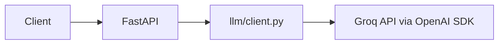

# docqa-api


A FastAPI service for asking questions over documents and getting answers with citations,
or a clear "not enough evidence" when the documents don't support one. Built in small,
tested steps; the document retrieval part is next.

## What it does today
| Endpoint | Behavior |
|---|---|
| `GET /health` | Liveness check, used by the Docker healthcheck and the deploy step |
| `POST /ask` | `{"question": "..."}` -> `{"answer": "...", "truncated": false}` from Groq via the OpenAI SDK |
| `POST /ask/stream` | Same input, answer streamed as Server-Sent Events: `delta` pieces, then `done` (with `truncated`), or `error` if the provider fails mid-stream |

Reliability built in: request timeout, bounded retries with backoff, provider 429 -> HTTP 429
with `Retry-After`, timeout/connection/5xx -> HTTP 503, and answers cut off at the token
limit are flagged `truncated: true` instead of passing as complete.

## Progress
| Task | What | Status |
|---|---|---|
| 1.1 | Repo and FastAPI skeleton, env-based config | Done |
| 1.2 | First model call through the provider SDK from `/ask` | Done |
| 1.3 | Notes on requests, responses and token limits | In progress |
| 1.4 | Timeout, bounded retries with backoff, 429 handling | Done |
| 1.5 | Handle truncated responses | Done |
| 1.6 | Streaming responses | Done |
| 1.7 | Structured logging (request id, latency, tokens, errors) | Next |
| 2.x | Document retrieval, citations, golden-set evals | Planned |

Delivery: every push runs ruff and pytest (24 tests, no real API calls). Merges to `main`
build a Docker image, push it to GHCR and deploy it to AWS EC2, then check `/health`.

## Failure handling, with tests
- Provider rate limit (429) -> bounded retries, then HTTP 429 with `Retry-After` ([tests](tests/test_client.py))
- Provider timeout, connection error or 5xx -> bounded retries, then HTTP 503 ([tests](tests/test_client.py), [tests](tests/test_api.py))
- Answer stopped at the token limit -> `truncated: true`; empty content handled ([tests](tests/test_truncation.py))
- Failure before the first streamed token -> real 429/503; failure mid-stream -> `error` event ([tests](tests/test_streaming.py))
- Invalid request body -> HTTP 422 ([tests](tests/test_api.py))

## Architecture

All model calls go through `app/llm/`, so timeouts, retries and error mapping live in one
place. Retrieval over Postgres + pgvector will sit between the API and the model.

## Quick start
```bash
python -m venv .venv && source .venv/bin/activate   # Windows: .venv\Scripts\activate
pip install -r requirements.txt
cp .env.example .env                                # add GROQ_API_KEY
uvicorn app.main:app --reload                       # docs at http://localhost:8000/docs
```
```bash
curl -X POST localhost:8000/ask -H "Content-Type: application/json" -d '{"question": "What is RAG?"}'
curl -N -X POST localhost:8000/ask/stream -H "Content-Type: application/json" -d '{"question": "What is RAG?"}'
```
On Windows PowerShell use `curl.exe`. Docker: `docker build -t docqa-api . && docker run --rm -p 8000:8000 --env-file .env docqa-api`. Tests: `ruff check . && pytest`.

| `.env` variable | Purpose | Default |
|---|---|---|
| `GROQ_API_KEY` | Groq API key | required |
| `GROQ_BASE_URL` | OpenAI-compatible endpoint | `https://api.groq.com/openai/v1` |
| `LLM_MODEL` | Model name | `llama-3.3-70b-versatile` |
| `MAX_COMPLETION_TOKENS` | Cap on generated tokens per answer | `5000` |
| `REQUEST_TIMEOUT_SECONDS` | Model-call timeout | `30` |

## Limitations
- `/ask` is a plain model call for now: no documents, retrieval or citations yet
- No evals or metrics yet; results will be added when the eval suite exists
- A failure after streaming starts can't change the HTTP status (already 200), so clients must watch for the `error` event
- Single EC2 instance; each deploy restarts the container with a few seconds of downtime

## Structure
```
app/main.py         routes            app/config.py   env settings
app/llm/client.py   model provider    app/schemas/    request/response models
tests/              24 tests          .github/workflows/ci-cd.yml   test, build, deploy
```
