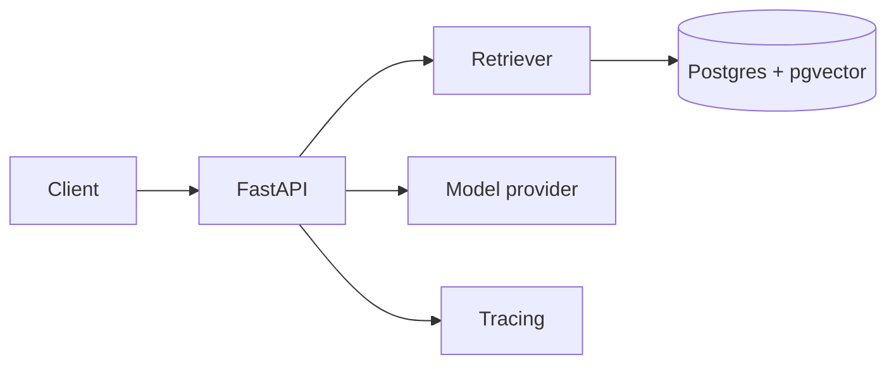

# docqa-api


Ask questions over a document set and get answers with citations, or a clear
"not enough evidence" when the documents don't support one.


## Why this exists
<2-3 sentences: the problem, who it's for, and what makes this version
different, e.g. every claim is cited and the system is tested on its failures.>

## Results
Measured on a <N>-question golden set built from <public dataset>.

| Iteration | Change | recall@5 | Latency (p50) | Notes |
|---|---|---|---|---|
| v1 | Vector search only | 0.62 | 450 ms | baseline |
| v2 | + hybrid search | 0.74 | 490 ms | [note](docs/experiments/006-hybrid.md) |
| v3 | + reranking | 0.81 | 900 ms | [note](docs/experiments/007-reranking.md) |

## Architecture

<One paragraph on the main design decisions and why.>

## Quick start
```bash
cp .env.example .env      # add your API key
docker compose up
curl localhost:8000/health
```

## Failure gallery
What happens when things go wrong, with the saved trace for each:
- Provider timeout -> retries, then a clear error ([trace](docs/traces/timeout.json))
- Prompt injection hidden in a document -> ignored ([test](tests/test_injection.py))
- Server killed mid-task -> resumes from saved state ([test](tests/test_resume.py))

## Evals
`python -m evals.run` runs the golden set and writes `evals/results/`.
CI runs it on every pull request.

## Limitations
<Be specific: corpus size tested, languages, known weak question types.>

## Project structure
<short tree and a one-line explanation per folder>