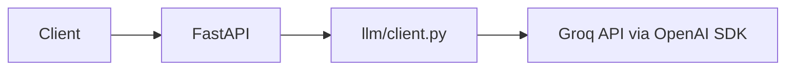

# docqa-api


A FastAPI service for asking questions over documents and getting answers with
citations, or a clear "not enough evidence" when the documents don't support one.

> **Status: in progress.** Today the service exposes a working `/ask` endpoint backed by
> Groq with timeouts, bounded retries and rate-limit handling, plus tests, Docker packaging
> and automated deploy. Document retrieval, citations and evals are the next projects
> (see [Roadmap](#roadmap)).

## Why this exists
Most LLM demos answer confidently whether or not they have evidence. This project is built
in small, measured steps, with every change tied to a tracker task, a PR and (from the eval
stage onward) a before/after metric, so the repo shows how the system was built and what
each step actually improved.

## What works today
| Area | State |
|---|---|
| `GET /health` | Returns `{"status": "ok"}`, used by the Docker healthcheck and deploy check |
| `POST /ask` | Takes `{"question": "..."}`, calls Groq (`llama-3.3-70b-versatile` by default), returns `{"answer": "..."}` |
| Resilience | Request timeout, up to 3 SDK retries with backoff; provider 429 -> HTTP 429 with `Retry-After`, timeout/connection/5xx -> HTTP 503 |
| Observability | Logs token usage and `finish_reason` per call; completion capped at 1000 tokens |
| Config | Env-based via pydantic-settings; no keys in code, `.env` is gitignored |
| Tests | pytest with the model call stubbed and provider errors mocked, so CI makes no real API calls and uses a dummy key |
| Lint | ruff on every push and PR |
| Container | Dockerfile (python:3.12-slim, non-root, healthcheck) |
| CI/CD | GitHub Actions: test -> build and push image to GHCR -> deploy to AWS EC2 over SSH, then `/health` check. Build and deploy run only on `main` |

## Results
No metrics yet. Retrieval and the eval suite arrive in project 2, and this table gets its
first row (recall@5 and latency on a golden set built from a public dataset) when they do.

| Iteration | Change | recall@5 | Latency (p50) | Notes |
|---|---|---|---|---|
| - | not measured yet | - | - | - |

## Architecture
Current:

Planned (project 2 onward): retrieval over Postgres + pgvector between the API and the
model, plus tracing.

Design choices so far: every model call goes through `app/llm/`, so timeouts, retries and
rate-limit handling have a single home and the API layer stays thin. The client uses the
OpenAI SDK against Groq's OpenAI-compatible endpoint (`GROQ_BASE_URL`), and provider errors
are translated into two domain exceptions that the API maps to 429 and 503.

Deployment: push to `main` -> GitHub Actions runs tests -> builds the image and pushes it to
GHCR tagged with the commit SHA and `latest` -> SSHes into EC2, pulls the SHA-tagged image,
restarts the container with a server-side env file, and checks `/health`.

## Quick start
Local:
```bash
python -m venv .venv && source .venv/bin/activate   # Windows: .venv\Scripts\activate
pip install -r requirements.txt
cp .env.example .env                                # add GROQ_API_KEY
uvicorn app.main:app --reload
```
Open `http://localhost:8000/docs`, or:
```bash
curl -X POST localhost:8000/ask -H "Content-Type: application/json" \
  -d '{"question": "What is RAG?"}'
```
Docker:
```bash
docker build -t docqa-api .
docker run --rm -p 8000:8000 --env-file .env docqa-api
```
Tests and lint:
```bash
ruff check . && pytest
```

Configuration (`.env`):

| Variable | Purpose | Default |
|---|---|---|
| `GROQ_API_KEY` | Groq API key | required |
| `GROQ_BASE_URL` | OpenAI-compatible endpoint | `https://api.groq.com/openai/v1` |
| `LLM_MODEL` | Model name | `llama-3.3-70b-versatile` |
| `REQUEST_TIMEOUT_SECONDS` | Model-call timeout | `30` |

## Failure gallery
What happens when things go wrong, with the test that proves it:
- Provider rate limit (429) -> bounded retries, then HTTP 429 with `Retry-After` ([test](tests/test_client.py), [test](tests/test_api.py))
- Provider timeout, connection error or 5xx -> bounded retries, then HTTP 503 ([test](tests/test_client.py), [test](tests/test_api.py))
- Missing `question` field -> HTTP 422 ([test](tests/test_api.py))

Planned for later projects:
- Prompt injection hidden in a document -> ignored
- Server killed mid-task -> resumes from saved state

## Evals
Not built yet. Planned: `python -m evals.run` runs a golden set and writes `evals/results/`,
and CI runs it on every pull request.

## Roadmap
| Task | Description | Status |
|---|---|---|
| 1.1 | Repo and FastAPI skeleton with env-based config | Done |
| 1.2 | First model call through the provider SDK, returned from `/ask` | Done |
| 1.3 | Notes on requests, responses, system instructions and token limits | In progress |
| 1.4 | Timeout, bounded retries with backoff, 429 handling | Done |
| 2.x | Retrieval over documents, citations, golden-set evals | Planned |

## Limitations
- `/ask` is a plain model call: no documents, no retrieval, no citations yet
- Retries are the SDK's built-in bounded retries; there is no circuit breaker or request queue
- The provider's rate limit is shared by all callers of this service; there is no per-client limiting
- Single EC2 instance, stop-and-start deploys with a few seconds of downtime per release
- SSH from the CI runner means port 22 can't be locked to one IP; key-only login is enforced

## Project structure
```
app/
  main.py          FastAPI app and routes
  config.py        env-based settings
  schemas/         request and response models
  llm/client.py    the only place that talks to the model provider
tests/             pytest, model call stubbed
evals/             golden set and results (to come)
.github/workflows/ci-cd.yml   test, build and push, deploy
Dockerfile
```
